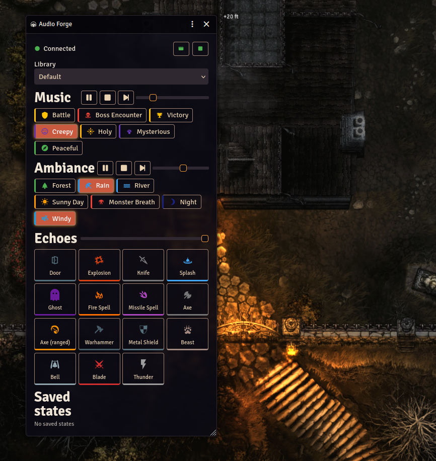

# Audio Forge for Foundry VTT

Drive the [Audio Forge](https://slashpaf.com/audioforge) soundboard from Foundry VTT over Audio Forge's Local API (HTTP + WebSocket). No cloud account or MQTT broker.



## What it does

- **Scene audio**: attach an audio profile to a scene (restore a saved Audio Forge state, or pick music and ambiance). It runs when the scene is activated, or on demand from the panel.
- **Combat audio**: separate profiles for combat start and combat end.
- **GM control panel** (sound controls button, or `Alt+A`): play/pause/stop/next per section, volumes, category toggles, echoes, saved states, library switch.
- **Macro API**: `game.modules.get("audioforge").api`.

Only GM clients connect; each GM talks to the Audio Forge on their own machine.

## Install

In Foundry: **Add-on Modules > Install Module**, paste this manifest URL, and install:

```
https://github.com/Slashpaf/audioforge-foundryvtt/releases/latest/download/module.json
```

Requires Foundry VTT v13 or newer. Tested on v14; v13 uses the same APIs but has not been run.

## Setup

1. Audio Forge: **Settings > Local API**, enable the server (default port `8329`).
2. Install this module and enable it in your world.
3. Module settings: host `localhost`, port `8329`. An API key is only needed for a non-local Audio Forge (also enable LAN access in Audio Forge).

The Local API is plain `http://`/`ws://`. Browsers allow that to `localhost` even from an HTTPS Foundry (recent Chrome versions may ask for local-network permission), but block it to any other host. If Foundry is served over HTTPS and Audio Forge is on another machine, the panel shows a "Blocked" message; serve Foundry over HTTP on that network instead.

## Scene and combat profiles

- Scene: right-click a scene in the Scenes directory > **Scene audio**, or use the header button in Scene Configuration.
- Combat: module settings > **Combat start audio** / **Combat end audio**.

A profile does one of: nothing, restore a saved state, or pick music and ambiance. Ambiance changes are explicit on/off commands (Audio Forge's own `play` toggles ambiance), so re-applying a profile never switches things off by accident. Use **Test now** in the editor to try it without saving.

## Macro API

```js
const af = game.modules.get("audioforge").api;
await af.play("Music", "Battle");
await af.playEcho("Thunder");
await af.setVolume("Ambiance", 0.6);   // 0..1, as shown in the app
await af.restoreState("Tavern night");
await af.send({ command: "stop", section: "All" }); // any Local API command
```

Hooks: `audioforge.connection(connected)`, `audioforge.state(state)`.

## Development

```sh
npm install
npm test        # client + profile logic against a mock Local API server
```

Symlink this folder into `Data/modules/audioforge`. The UI has been run on Foundry v14 with Audio Forge on the same machine. The code targets the v13 API, but v13 itself is untested.

Releases: bump `version` in `module.json`, push a matching `vX.Y.Z` tag, and the workflow creates a **draft** release with `module.json` and `module.zip` for review. Publish the draft so the `latest/download` manifest URL resolves.

## License

MIT for the code. Audio Forge's name, branding and the bundled logo glyph are not covered; see [ASSET_LICENSE.md](ASSET_LICENSE.md).
